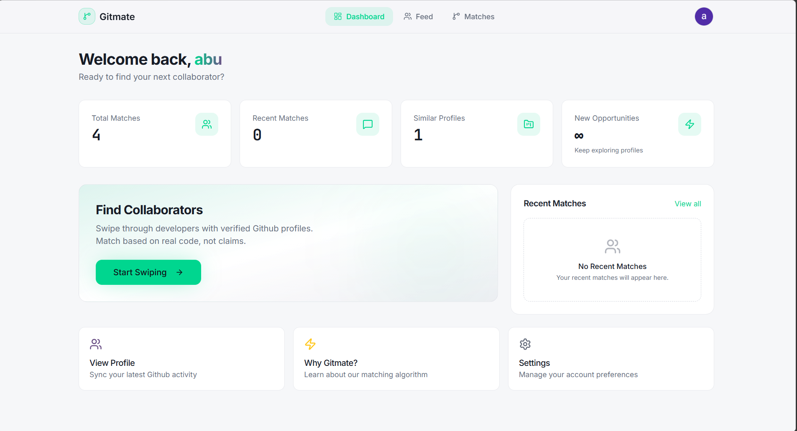
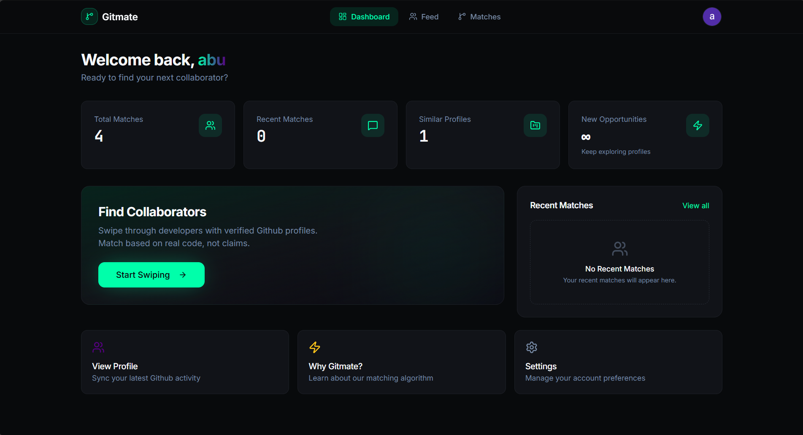
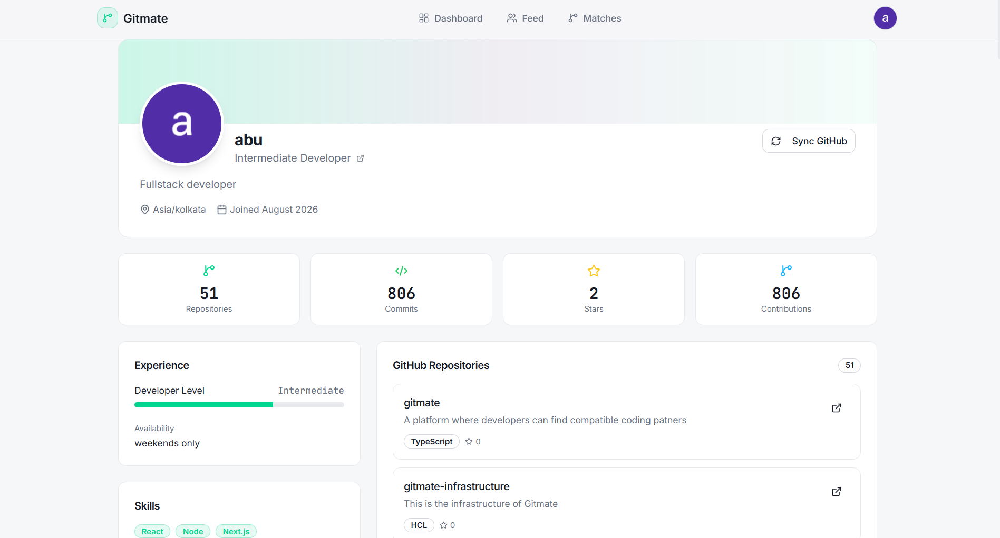
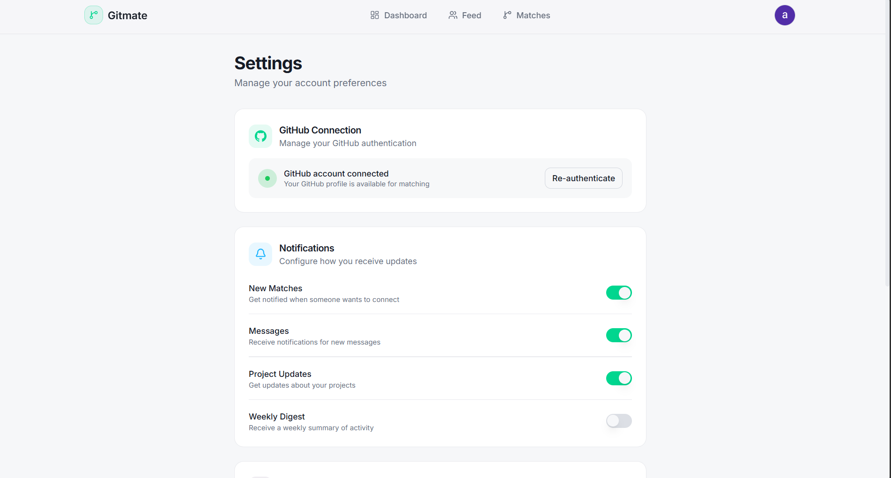
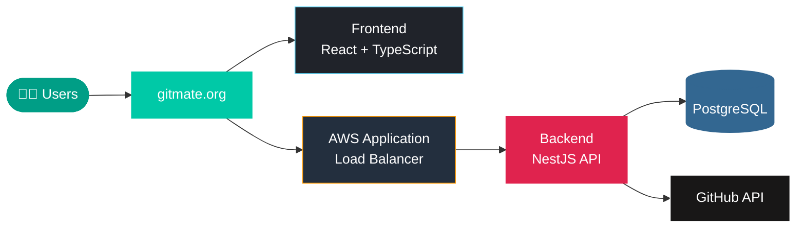

<div align="center">


**Match with developers based on real code, not resumes.**
<br />
Build together. Grow together.

<br />

[](https://gitmate.org)
[](https://react.dev)
[](https://www.typescriptlang.org)
[](https://nestjs.com)
[](https://aws.amazon.com)

[**Live Demo**](https://gitmate.org) · [**Report a Bug**](../../issues) · [**Request a Feature**](../../issues)

<br />



</div>

<br />

## 💡 Why Gitmate?

Finding the right coding partner is hard. Skills, interests, and availability all have to line up, and a random Discord server rarely delivers. Resumes and bios only tell you what people *claim*.

Gitmate connects to your GitHub, reads what you actually build, and matches you with developers whose goals, experience, and availability fit yours.

<br />

## ✨ Features

<table>
  <tr>
    <td width="50%" valign="top">
      <h3>🔗 Verified GitHub Profiles</h3>
      Sign in with GitHub and sync your repositories, commits, and stars. Your profile reflects real work.
    </td>
    <td width="50%" valign="top">
      <h3>🎯 Similarity Matching</h3>
      Every developer in your feed comes with a similarity score based on goals, experience, and availability.
    </td>
  </tr>
  <tr>
    <td width="50%" valign="top">
      <h3>👆 Swipe to Connect</h3>
      Pass, star, or like. Mutual interest turns into a match.
    </td>
    <td width="50%" valign="top">
      <h3>💬 Built-in Chat</h3>
      Talk to your matches directly without leaving the platform.
    </td>
  </tr>
  <tr>
    <td width="50%" valign="top">
      <h3>📊 Personal Dashboard</h3>
      Track your matches, similar profiles, and new opportunities at a glance.
    </td>
    <td width="50%" valign="top">
      <h3>🌗 Light & Dark Mode</h3>
      A clean, responsive interface that looks great in both themes.
    </td>
  </tr>
</table>

<br />

## 📸 Screenshots

### Discover developers

<div align="center">

</div>

### Dashboard, in light and dark

<div align="center">

| Light | Dark |
|:---:|:---:|
|  |  |

</div>

### Profile and settings

<div align="center">

| Profile | Settings |
|:---:|:---:|
|  |  |

</div>

<br />

## 🛠️ Tech Stack

<div align="center">


</div>

<!-- | Layer | Technology |
|---|---|
| **Frontend** | React, TypeScript, Vite, TanStack Query, React Router |
| **Styling** | Tailwind CSS, shadcn/ui |
| **Backend** | NestJS, Node.js |
| **Database** | PostgreSQL (pgvector), Prisma |
| **Auth** | GitHub OAuth |
| **Infrastructure** | AWS, Application Load Balancer, Terraform |
| **CI/CD** | GitHub Actions |
| **Hosting** | Vercel (frontend), AWS (backend) | -->
<br>
<br>
<div align="center">
  <table>
    <thead>
      <tr>
        <th align="center">Layer</th>
        <th align="center">Technology</th>
      </tr>
    </thead>
    <tbody>
      <tr>
        <td><strong>Frontend</strong></td>
        <td>React, TypeScript, Vite, TanStack Query, React Router</td>
      </tr>
      <tr>
        <td><strong>Styling</strong></td>
        <td>Tailwind CSS, shadcn/ui</td>
      </tr>
      <tr>
        <td><strong>Backend</strong></td>
        <td>NestJS, Node.js</td>
      </tr>
      <tr>
        <td><strong>Database</strong></td>
        <td>PostgreSQL (pgvector), Prisma</td>
      </tr>
      <tr>
        <td><strong>Auth</strong></td>
        <td>Google & GitHub OAuth</td>
      </tr>
      <tr>
        <td><strong>Infrastructure</strong></td>
        <td>AWS, Terraform</td>
      </tr>
      <tr>
        <td><strong>CI/CD</strong></td>
        <td>GitHub Actions</td>
      </tr>
      <tr>
        <td><strong>Hosting</strong></td>
        <td>AWS </td>
      </tr>
    </tbody>
  </table>

<br />

## 🏗️ Architecture



Frontend, API, and database are separate layers, so each can be deployed and scaled independently. Infrastructure is managed with Terraform and shipped through GitHub Actions.

<br />

## 🚦 Run it locally

```bash
# Clone
git clone https://github.com/ABUBAKAR-DAHIR/gitmate.git
cd gitmate

# Install
pnpm install

# Configure (point this at your running backend)
echo "VITE_API_URL=http://localhost:3000" > .env

# Start
pnpm dev
```

Open **http://localhost:5173** and you're in.

> [!NOTE]
> `VITE_` variables are bundled into the client. Never put secrets in them.

<br />

## 🤝 Contributing

Contributions, suggestions, and bug reports are welcome.

1. Fork the repository
2. Create a branch: `git checkout -b feat/your-feature`
3. Commit your changes
4. Open a pull request

<br />

## 👤 Author

<div align="center">

**Abubakar Dahir Hassan**

Full-stack developer building production-ready applications, backend systems, and cloud infrastructure.

[](https://github.com/ABUBAKAR-DAHIR)
[](https://www.linkedin.com/in/abubakar-dahir/)

<br />

⭐ **If you like Gitmate, give it a star!**


</div>
